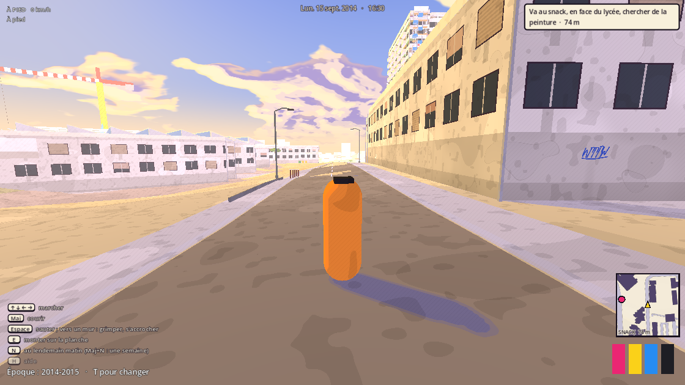
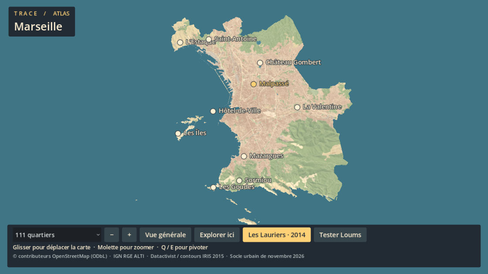
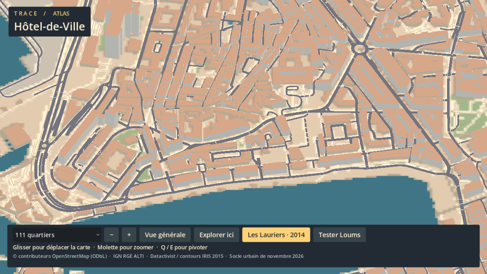
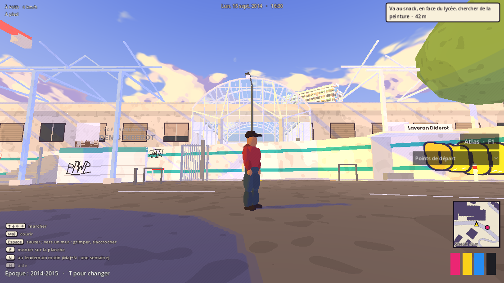
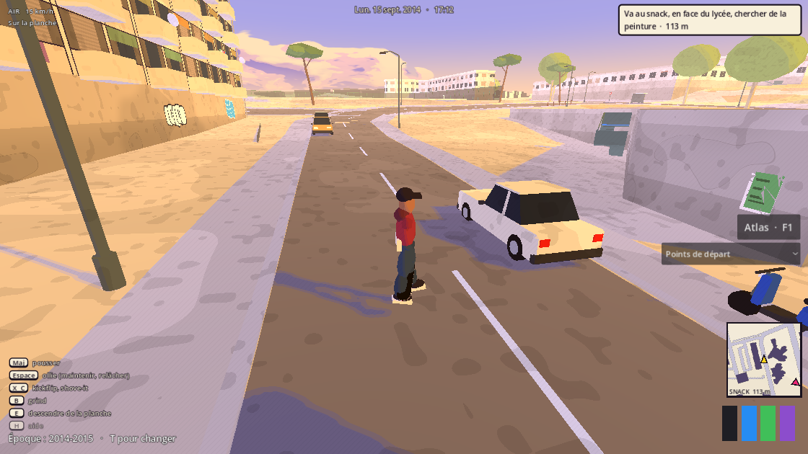
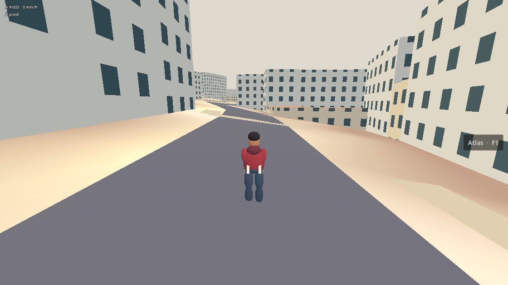

# TRACE · Carnet de construction

Captures du jeu exécuté dans Godot 4.7.2, à 1 120 × 630 pixels.

### 1. Rue de Marathon au départ du travail
La rue et les volumes historiques étaient déjà présents. En l’absence du modèle privé de Loums, le projet affichait une capsule orange.

### 2. Atlas des 111 quartiers
Carte locale de la commune, des îles et de son relief. Les boutons donnent accès à la scène de 2014 et à la cour de test.

### 3. Zoom près du Vieux-Port
Les tuiles de proximité ajoutent les emprises et les volumes du bâti actuel.

### 4. Boulevard Lavéran devant Diderot
La verrière et la façade du lycée servent de repères pour le départ à pied. La doublure articulée est visible au premier plan.

### 5. Ollie rue de Marathon
Image prise après la poussée, le virage et le relâchement d’Espace dans le test de déplacement. Le test vérifie ensuite la réception et le freinage.

### 6. Exploration hors du quartier historique
Vue à hauteur de rue dans le deuxième arrondissement, obtenue depuis le bouton « Explorer ici ». Cette image donne un point de comparaison avec le niveau de détail des Lauriers.

