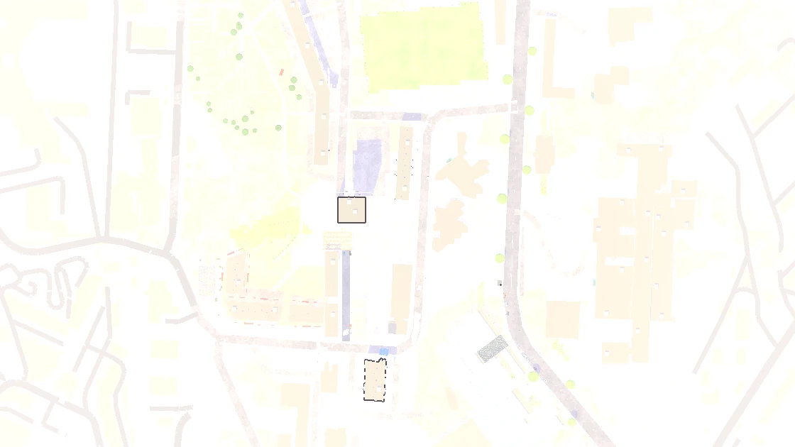

# Carte de contrôle de Malpassé

État du modèle Godot examiné le 20 novembre 2026 sur la branche `feature/marseille-explorable`, révision `9cb2053`. Le départ Diderot appelle le quartier avec le filtre historique `avant`. Le fond des Lauriers mélange ainsi le quartier du jeu vers 2014, des géométries cartographiques plus récentes et la visite de la façade ancienne du lycée. Cette planche est un document de production.

## Registre des contrôles

| N° | Point en mètres (X est, Z sud) | Constat et décision avant intervention |
| --- | --- | --- |
| 1 | −125, 64 | Depuis l’est, le rayon horizontal heurte `Limite3` à x = −124,5. Le centre de l’amphithéâtre est à −131. Décider du périmètre jouable et tracer une limite qui conserve la continuité des surfaces aux deux extrémités du passage. Le décor de la place du Jardin est une adaptation du jeu. |
| 2 | −8, −21 | L’intersection de la ligne piétonne active et de l’emprise provisoire de la tour B mesure 24,98 m en plan. Elle entre par (−17, −24,13) et sort par (7, −17,19). Comparer une image aérienne historique à plusieurs angles de façade avant de choisir quel élément corriger. |
| 3 | −11,8, 13 | Le rayon à hauteur humaine touche le corps `Passage_sombre`. Déterminer la destination réelle de cette ouverture avant de la transformer en passage ou de la représenter comme une porte fermée. |
| 4 | −15, 9 | À PAIX, le calcul du plateau donne Y = 5,5152 m contre 0,9152 au pied de référence. Cela représente une hauteur de 4,60 m dans le jeu. Relever pied, palier et débouché. Tester séparément montée à pied et retour roulant. |
| 5 | 125, 75 | La cote locale passe de −5,19 à −1,351 m sous l’effet du lissage. Devant la façade, à (142, 90), l’écart tombe à +0,53 m. Prendre une coupe commune chaussée, bordure, trottoir et seuil. |
| 6 | 124, 42 | Le script pose le snack à un emplacement explicitement hypothétique. Suspendre les déclencheurs de rendez-vous ou de ravitaillement jusqu’à son identification. |
| 7 | 128,5, 91,5 | Point d’axe de la façade de Diderot. Le passage central côté boulevard a été testé lors de la livraison précédente. Relever les cotes restantes avant de figer les raccords du seuil. |

## Relief et bord de carte

La grille locale contient 17 × 25 valeurs espacées de 25 m. Le maillage affiné est interpolé à 5 m. L’axe Lavéran est lissé deux fois par moyenne sur ±60 m, avec correction latérale pleine jusqu’à 15 m et transition jusqu’à 30 m. Sur les 9 801 points testés à 5 m dans le rectangle local, 912 présentent un écart absolu supérieur à 50 cm entre les deux surfaces. Le minimum vaut −4,18 m à (165, −325) et le maximum +3,84 m à (125, 75). L’échantillonnage compare deux versions du terrain dans le moteur. Les bordures et ouvrages de quelques centimètres exigent d’autres références.

La jupe visuelle borde le rectangle physique de 400 × 600 m. Son contour adopte le terrain communal à 64 m. Pour le bâti municipal, un sommet dans le rectangle élargi de 10 m suffit à supprimer le bâtiment entier. Pour la voirie, une extrémité dans le rectangle élargi de 12 m suffit à supprimer le segment entier. Contrôler les franchissements externes par rue avant de programmer les transitions.

## Secteurs proposés

Commencer par PAIX → Marathon et les deux côtés de la limite ouest. Les jalons de validation sont une boucle à pied et une boucle en skate, chacune avec retour au départ, puis des parcours facultatifs vers les toits ou les spots. Les essais de cette passe portent sur la physique statique, le relief et les tracés. Les missions et boucles complètes restent à réaliser.

## Traçabilité

- Géométries actives, variantes d’époque et relief initial : `data/quartier_reel.txt`.
- Tests de masque et terrain : `scripts/quartier_reel.gd`, `scripts/ville_terrain.gd`.
- Collisions du plateau et de la place : `scripts/habillage.gd`, `scripts/habillage_place.gd`.
- Ancrages de jeu : `scripts/habillage_laveran.gd`, `scripts/habillage_toits.gd`.
- Sources et licences : [décisions de production](../DECISIONS.md). Contrôles précédents du portail : [Diderot](DIDEROT.md).
