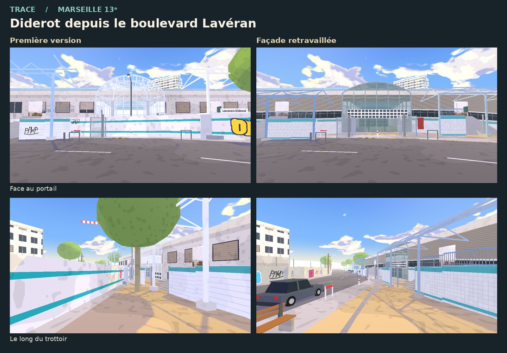

# Diderot depuis le boulevard Lavéran

Le départ **Diderot · 2012–13** place Loums sur le boulevard face à la verrière. Traverser la chaussée à pied mène au portail. Le temps de la visite est fixé à 13 h 30 pour rendre les matériaux comparables d’une version à la suivante. F1 ramène à l’atlas. En local, lancer `./run.sh diderot`. Sur le site, ouvrir `/?depart=diderot` pour jouer ou `/diderot.html` pour voir les captures.

## Quelle époque voit-on ?

Il s’agit du **lycée Denis Diderot, 23 boulevard Lavéran, Marseille 13e**. Le programme régional de 2014 décrit le déplacement de l’entrée et la restructuration de la nef. La Métropole date l’achèvement de la rénovation de 2016. Les travaux se sont déroulés par phases. La version « 2012–13 » représente l’aspect ancien demandé pour le boulevard. Le millésime exact des trois photographies fournies et le phasage du chantier devant chaque travée restent à confirmer. La mention ©2020 de la vue de rue indique un copyright.

[AREA Région Sud, fiche du lycée](https://www.arearegionsud.com/realisations/lycee-denis-diderot/) · [Programme régional de juin 2014, opération 90UB](https://citoyen-ne-s-de-marseille.fr/wp-files/eg-transparency/REGION/DELIBERATIONS/Commission%20permanente/2014-06-27/CP-14-661%20-%20Am%C3%A9lioration%20des%20Conditions%20d%27AccueilRevalorisation%20de%20bilans%20financiers%20pr%C3%A9visionnelsAvenants%20%C3%A0%20des%20Contrats%20de%20pre/CP-14-661_S0Q7R.pdf) · [Métropole, dossier de Malpassé, rubrique « Lycée Denis Diderot »](https://deliberations.ampmetropole.fr/documents/metropole/deliberations/2022/11/17/ANNEXE/34947_3%20-%20Annexes%20A.pdf)

| Référence fournie | Éléments repris ou écartés |
| --- | --- |
| Vue en biais depuis le boulevard, 104138 | Grille métallique sur le muret carrelé, bandeaux turquoise, poutres bleues et contreventements, plaque rouge, voitures en stationnement. La plaque reste sans texte car il est illisible. |
| Vue frontale ancienne, 104443 | Gable vitré en arc surbaissé, montants blancs, trois rangées de petites baies au-dessus des portes. Le portail ouvert permet le passage de Loums. |
| Vue anthracite avec panneaux rouges, 104340 | Document de comparaison avec le traitement rénové. |
| Étude couleur Higgsfield / Nano Banana | Essai de palette indépendant des mesures. Les images livrées dans ce carnet proviennent de Godot. |

## Construction et limites

L’emprise métrique et le tracé du boulevard proviennent du projet géoréférencé. Les hauteurs du mur (2,5 m), de la charpente (environ 5 m sous traverse), l’entraxe (environ 5,5 m), les carreaux (22 cm) et la courbure de la verrière sont des estimations visuelles. Les divisions de vitrage, la pose du béton et les emplacements précis des voitures sont simplifiés. Les matériaux de façade et de sol sont calculés dans le moteur. Les photos fournies restent des documents de travail privés.

La collision du muret continu a été corrigée devant la baie centrale. La structure bleue, les piliers et les grilles fixes possèdent des volumes de collision. Les tringles fines sont regroupées. La peau du trottoir suit la surface de déplacement du quartier. La visite utilise les mêmes commandes de marche et de skate que les Lauriers. Les étages, les salles et les coursives hérités du prototype restent des décors de jeu hypothétiques. Le chantier générique et l’abribus hypothétique devant la verrière sont retirés de cette visite. Les dimensions de l’avant-cour et les anciennes portes secondaires demandent encore des vues datées ou des plans d’époque.

Les attributions OSM et IGN sont détaillées dans [DECISIONS.md](../DECISIONS.md). Les trois aides Godot installées dans le projet (`.agents/skills`) proviennent du [catalogue fourni](https://github.com/gamedev-skills/awesome-gamedev-agent-skills) à la révision inscrite dans REVISION. La licence Apache 2.0 et NOTICE accompagnent les fichiers.

## Vérifications du 20 novembre 2026

- Lancement local du quartier avec Godot 4.7.2 et chargement de la scène depuis le paquet exporté pour le Web.
- Cinq contrôles sur le départ historique. Le personnage est posé sur le boulevard et franchit le portail par les commandes ordinaires. Distance de 14,54 m au pas de physique fixe, contact au sol à l’arrivée.
- Dans les Lauriers, huit contrôles couvrent la montée de l’escalier, le palier, le départ Lavéran et la boucle de skate avec poussée, virage, ollie, réception et freinage. Les neuf contrôles du terrain et les quatorze contrôles de la suite « solide » passent également.
- Captures à hauteur de rue avec la même focale et la même lumière pour comparer les versions. La vue joueur est prise avec la caméra de Loums.
- À 1 120 × 630 sur Mesa llvmpipe, 42 intervalles donnent 152 ms par image en médiane, 165 ms au 95e centile, environ 6,6 images/s. Mesure du rendu logiciel au départ Diderot. Les performances sur GPU et téléphone restent à mesurer.
- L’aperçu du site et son lien vers Diderot ont été ouverts dans le navigateur de test. Il indique l’absence de WebGL 2 et affiche les captures. La validation des déplacements a été effectuée dans Godot natif.
- L’audit de caméra du catalogue trouve une caméra, une lumière et un éclairage ambiant. Il signale aussi les géométries situées derrière la caméra ou au-delà de sa portée. Ce dernier critère n’est pas adapté à une carte ouverte. Un arrêt de test immédiat peut encore signaler des ressources résiduelles à la fermeture du moteur.
