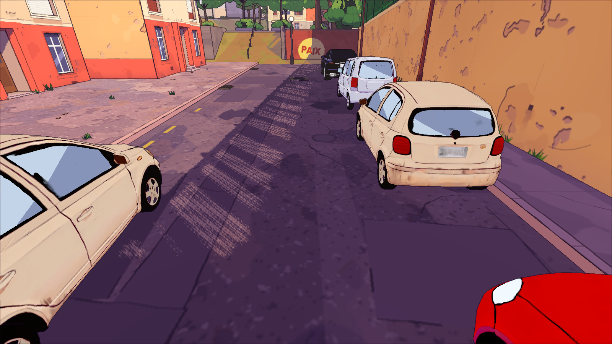
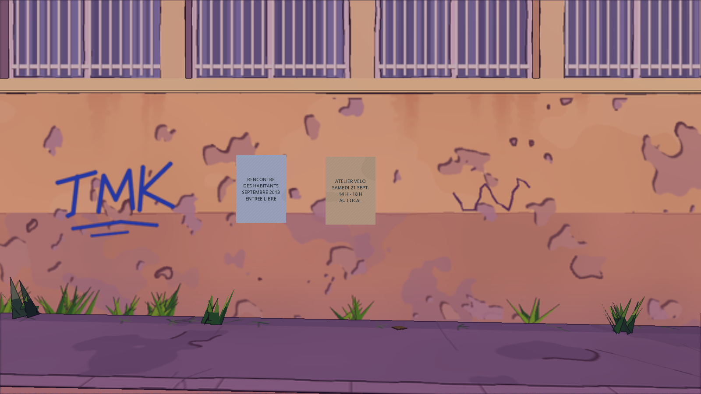

# TRACE — habiter Marseille en 2013

Diagnostic et premier lot du 20 novembre 2026. Cible demandée : donner de la matière, du détail et une vie quotidienne au quartier déjà jouable.

**Correction historique du 20.11 :** le lancement par défaut utilise maintenant la scène 2013. Elle conserve la grande tour Cyprès B et impose l’époque historique, même après une visite du quartier contemporain. La comparaison T reste accessible dans la scène de développement `lauriers.tscn`. Onze contrôles dédiés vérifient le lancement, le retour depuis un ancien état de démolition, le modèle visible et ses collisions. Les nouvelles références depuis le toit du lycée servent au recalage ; les captures actuelles montrent encore des écarts de géométrie et de cadrage. Détail dans [CARTE_JOUABLE.md](CARTE_JOUABLE.md).

## Diagnostic

La fondation est déjà là. Le meilleur investissement est de terminer un parcours continu à hauteur de Loums : impasse de la Paix → pied des Cyprès → rue de Marathon → lycée → snack → retour au premier mur. La géographie, les pentes et les gestes servent ce parcours ; chaque zone doit aussi raconter un usage du lieu.

L'impasse possède déjà une direction visuelle convaincante : enduit ocre, soubassements rouges, ombres violettes, pins, façades peintes et stationnement. Les grands espaces autour des tours restent beaucoup plus uniformes. La prochaine passe doit traiter ces raccords, les entrées et les sols avec la même précision que la rue pilote.

Le récit de la ville doit passer par les usages : sortir du lycée, attendre, discuter, réparer un vélo, acheter à manger, choisir où laisser une trace. Éviter de faire de chaque coin un spot de skate ou un mur sale. Les lieux entretenus, les pauses et les plantes comptent autant que l'usure.

## Ce qui est effectivement présent

| Couche | Observation dans les fichiers et au lancement | Limite actuelle |
|---|---|---|
| Géographie | Contours OSM, grille IGN, routes, murs, stade, lycée, tours et grande barre | Le relevé OSM est daté du 19.11.2026 ; ce n'est pas un état cadastral de 2013. Hauteurs et styles sont estimés. |
| Déplacements | Marche, course, skate, ollie, flips, grind, grimpe, véhicules | L'existence du code ne valide pas le ressenti ; pas de nouveau test humain effectué ici. |
| Décor | Le lancement charge 26 bâtiments peints, 95 lampadaires, 94 arbres et 500 éléments de graffiti/affichage | Les chiffres du log sont des éléments construits, pas le nombre d'objets visibles à l'écran. |
| Matériaux | Shaders de façades, sols, pierre, pavés ; décor peint avec lumière dédiée | Les traitements génériques et peints se voient côte à côte ; surveiller leur échelle et les raccords. |
| Vie du quartier | Habitants avec rôles, rondes et réactions ; mission snack → mur → snack | `AVEC_FIGURANTS = false` dans `habitants.gd` : la foule annoncée dans la documentation n'est pas activée. |
| Temps | Horloge, nuit, vieillissement, comparaison avant/après | Le calendrier principal démarre en 2014 ; « avant » recouvre une période large, pas une reconstruction validée de 2013. |

Inventaire local sous `assets/decor` : 86 GLB (123,1 Mio sur disque), 569 images PNG/JPG/WebP (74,8 Mio), sans les fichiers `.import`. Ce ne sont ni la mémoire GPU ni la taille d'un export. Les sources de génération de la rue et des bâtiments sont déjà conservées : les réutiliser avant de multiplier les nouveaux packs.

## GitHub et copie locale

Dépôt consulté : [negoatapp-cyber/TRACE](https://github.com/negoatapp-cyber/TRACE), arbre de `main` au commit `f0f81b6f51fb3074766800ed54f3f4743d878e57`.

Comparaison de 91 fichiers distants dans scripts/scènes/shaders/données/docs et `project.godot` : 64 identiques, 27 différents, aucun absent localement. Comparaison par hash Git, avec normalisation CRLF/LF. Ce contrôle a été fait après la modification locale de `temps.gd` de cette étude ; les 27 écarts ne sont donc pas tous antérieurs. Il ne couvre pas la totalité des assets ni les fichiers uniquement locaux.

Le dossier de travail n'a pas de `.git`. Les modifications de cette intervention sont locales ; aucune publication, fusion ou mise à jour distante n'a été effectuée. Avant intégration, comparer les changements antérieurs du gameplay avec GitHub. Ne jamais remplacer cette copie en bloc.

## Direction visuelle à conserver

**Échelle et lecture.** Un mètre Godot correspond à un mètre du quartier. Tester en troisième personne, à 1600 × 900 comme le projet, puis sur téléphone. Chaque accès de gameplay doit rester lisible avec l'encrage activé.

**Palette.** Crème, ocre, terre cuite, béton rosé, métal vert délavé et bleu de ciel ; ombres violettes existantes. Réserver les fortes saturations à Loums, à ses traces et à quelques repères utiles.

**Usure.** La placer selon sa cause : coulures sous appuis, poussière au pied des murs, arrachement près des portes, reprises sur les tranchées de chaussée, lustrage sur les surfaces réellement utilisées. Réduire les taches réparties uniformément. Varier les ouvertures, volets et usages des balcons avant d'ajouter du bruit fin.

**Trois distances.** À 50 m : silhouette et accès. À 10 m : rez-de-chaussée, balcon, enseigne et matières. À 1–3 m : joints, boîtes aux lettres, affiche, poignée et trace d'usage. La finesse doit d'abord tenir dans la vue de jeu.

## Premier résultat livré

| Élément | Réalisation | Statut |
|---|---|---|
| Version d'étude | `scenes/marseille_2013.tscn`, héritée du quartier existant | Jouable localement via `Jouer-Marseille-2013.cmd` |
| Date | Lundi 16 septembre 2013 à 16 h 30 | Choix de mise en scène, pas une date historique attestée de l'histoire de Loums |
| Voirie | Dix avaloirs, trois tampons avec reprises d'enrobé, 48 feuilles/papiers discrets | Géométrie originale procédurale, placements plausibles, sans collision supplémentaire |
| Vie quotidienne | Deux petites affiches : atelier vélo et rencontre des habitants | Textes fictifs, sans marque, avec typographie native Godot |
| Regroupement | 175 petites pièces de voirie regroupées en huit MultiMesh | Portée visuelle de 95 m ; cela ne constitue pas une mesure du gain de performances |
| Horloge | Date de départ et fichier de sauvegarde configurables dans `temps.gd` | Défauts 2014 conservés pour la partie principale ; fichier d'horloge distinct pour l'étude |
| Captures | Dossier de sortie créé automatiquement et échec de sauvegarde signalé | Le script accepte maintenant une scène en cinquième argument utilisateur |

Les façades, voitures, arbres, peintures et textures visibles étaient déjà dans le projet. Ce premier lot ne refait pas leurs textures ; il sert à vérifier le placement de microdétails et le cadre 2013 dans le vrai quartier. Aucun nouveau pack extérieur ou asset généré par IA n'a été ajouté.

Les autres systèmes de sauvegarde (mission, graffiti, etc.) conservent leur fonctionnement partagé. Seule l'horloge est séparée. Pour les tests automatisés, `APPDATA` a été redirigé vers `.tools/runtime_data`, afin de ne pas toucher aux sauvegardes personnelles.





## Plan de production proposé

Les critères ci-dessous sont des cibles de travail, pas des résultats déjà acquis. Procéder lot par lot avec comparaison de captures aux mêmes positions.

| Ordre | Zone / travail | Livrable concret | Critère de sortie proposé |
|---|---|---|---|
| 1 | Vérification 2013 sur le parcours | Fiche par lieu : source, date de prise de vue, détail observé et niveau de confiance | Chaque silhouette, chantier et accès qui change selon l'époque a une référence datée ou une mention « hypothèse ». |
| 2 | Raccord impasse → Cyprès | Sols raccordés, véritables entrées lisibles, seuils, pieds de façade, trottoirs et stationnement cohérents | Un aller-retour à pied et en skate sans obstacle invisible, sol superposé ni matière qui change brutalement. |
| 3 | Rue de Marathon | Rez-de-chaussée variés, portails, locaux, boîtes aux lettres, balcons et linge sélectionnés | Trois points de vue de rue reconnaissables sans afficher leur nom ; aucune répétition de façade immédiatement dominante. |
| 4 | Lycée → snack | Cohérence du mur carrelé, verrière et mobilier ; zone d'attente et équipements du snack | Le joueur trouve l'accès et le ravitaillement dans une vue de jeu normale ; trajectoires des habitants dégagées. |
| 5 | Vie et son localisés | Quelques habitants avec destinations, rendez-vous au snack, sons spatialisés de proximité | Une traversée de dix minutes présente des activités et pauses visibles ; évaluer sur une vraie partie humaine. |
| 6 | Harmonisation et optimisation | Palette commune, détails proches, silhouettes lointaines, rapports PC et téléphone | Mesurer avant/après sur le même trajet : temps d'image, appels de dessin, mémoire et chargement ; ajuster au matériel cible. |

### Famille de matériaux à produire au lot 2

| Matière | Travail attendu | Réutilisation |
|---|---|---|
| Enrobé ancien | Grain peint mesuré, reprises de tranchées, variations sobres | Chaussées et stationnements, sans transformer chaque route en damier de plaques |
| Béton de trottoir | Joints et éclats surtout sur arêtes, bordures claires | Accès, seuils, escaliers et petits murets |
| Enduit crème / ocre | Trois variantes d'usure causée par l'eau et l'usage | Garder les façades peintes singulières, employer le matériau générique sur les raccords |
| Soubassement rouge | Écaillage proche des portes et coins exposés | Rue de Marathon et impasse, avec variantes entretenues |
| Métal peint vert / bleu | Décoloration, petites reprises et rouille aux attaches | Grilles, portails et mobilier |
| Sol sec et végétation | Limites terre/béton crédibles, herbe par poches | Talus et pieds de tours ; ne pas recouvrir tous les vides de la même texture |

[PROPOSITION] Commencer par des textures de 1024² pour les surfaces répétées, avec mipmaps et une densité homogène ; tester les répétitions et réserver les grandes textures peintes aux façades particulières. Choisir la résolution définitive après mesure à hauteur de joueur et sur téléphone. Les budgets ne sont pas encore profilés.

## Fidélité à 2013 : règle de preuve

### Corpus photographique fourni le 20 novembre 2026

44 photos ont été examinées et cataloguées localement, avec dimensions, appareil, date EXIF et empreinte SHA-256. L’utilisateur a confirmé les dates des appareils. Répartition : 11 clichés de février 2010, 28 de 2012, trois du 13 janvier 2013 et deux du 21 mars 2014. Les lieux précis ne sont pas encore renseignés. Une date de prise de vue antérieure ne prouve pas que la même peinture était toujours présente en septembre 2013.

Les vues `SAM_0966` et `SAM_0967` (composition avec une rose) sont postérieures à la cible 2013 : référence de composition seulement. Les trois clichés de janvier 2013 sont `SAM_0890`, `SAM_0892` et `SAM_0898`. Aucun doublon binaire parmi les 44 fichiers ; quatre paires montrent un même sujet sous des cadrages différents (`0571/0578`, `0818/0820`, `0882/0883`, `0966/0967`).

Catalogue, manifeste et deux planches de consultation : `.tools/references_2013/`. Ces fichiers restent locaux et ignorés par les règles Git du projet. Les originaux n’ont pas été modifiés.

**Premier habillage intégré, après précision de l’utilisateur.** Les photos servent effectivement au décor du jeu : une reconstruction assistée par l’outil image du LOUMS bleu de `SAM_3356` (2048 × 1024, alpha réel) et un crépi dérivé de `SAM_0563` (1024²) sont présents dans la scène principale et l’étude 2013. Ce sont des dérivés générés, pas des extractions photographiques pixel pour pixel. Le crépi module le grain du soutènement sans remplacer sa palette peinte. Le graffiti occupe 4,6 m sur le mur, avec projection limitée pour éviter le lampadaire. Un tuyau avec colliers et un couronnement de tuiles en relief complètent ce premier lot, inspirés des détails photographiés. Les collisions existantes sont conservées.

Implémentation : `scripts/habillage_photos.gd`, branche optionnelle du shader `decor_peint.gdshader`, nœud `HabillagePhotos` dans `scenes/lauriers.tscn`. Textures et provenance détaillée avec prompts : `assets/graffitis/photos_2013/manifest.json` (privé). Si les textures privées sont absentes, ce nœud ignore l’habillage et conserve le quartier jouable.

Validation du lot : dimensions et transparence contrôlées par `asset_report.py` ; mipmaps activés ; planche d’assets inspectée ; trois captures Forward+ de la scène principale inspectées dans `.tools/review_photos_final/`. Quinze contrôles existants de l’étude réussis dans `.tools/verify_photos.log`, notamment stabilité au sol sur cinq points et calendriers distincts. Pas de test téléphone effectué. Les avertissements de libération de ressources à la fermeture restent présents. Ce premier lot ne traite pas encore les 44 photos.

| Priorité | Photos de référence | Application concrète à TRACE | Limite |
|---|---|---|---|
| 1 | `SAM_0563`, `SAM_3416`, `SAM_3385` | Enduits : grain à petite échelle, reprises de teinte plus larges, fines fissures ; laisser des pans entretenus | Refaire une matière réutilisable ; la photo oblique contient déjà lumière et peinture |
| 2 | `SAM_0796`, `SAM_0797`, `SAM_0788` | Séparer béton banché et blocs : joints, trous de coffrage et arêtes ne suivent pas le même motif | Ne pas appliquer une grille de parpaings à tous les murs |
| 3 | `SAM_0738`, `SAM_0739`, `SAM_0565` | Murets : couronnement en tuiles, tuyau horizontal, attaches, seuil herbe/enduit | Modéliser les éléments qui changent la silhouette ; éviter de les aplatir dans la texture |
| 4 | `SAM_3365`, `SAM_3408` | Varier volets, balcons, linge et clôtures sur les raccords du parcours | Localisation et correspondance avec les bâtiments du jeu à confirmer |
| 5 | `SAM_3356`, `SAM_3383` | Étudier le vocabulaire LOUMS : volumes arrondis, contours contrastés, rehauts rayés ; préserver le support métal de `3383` | Attributions des différentes œuvres à préciser avant une bibliothèque nominative |
| 6 | `SAM_3389`, `SAM_0822`, `SAM_3419` | Végétation derrière les murets, feuilles sur couronnement ; usure ciblée des menuiseries et appuis | Le vitrage brisé sert aux lieux abandonnés, pas à toutes les façades habitées |

Pour la prochaine passe de matériaux : construire d’abord enduit, béton banché et blocs sans lettrage ; poser ensuite les traces avec le système de marques murales existant. Les coulures et reprises dépendent du support. Les ombres des arbres et des ferrures restent produites par la lumière du jeu. Vérifier les répétitions à 1–3 m et la lecture à 10 m, en gardant l’encrage actuel. Les photos de friches et les vues très déformées documentent surtout les couches et les usages ; elles ne définissent pas l’état de toutes les rues du quartier.

Trois niveaux : **attesté** (document daté du lieu), **analogie** (référence proche en date ou dans le quartier), **fiction plausible** (accessoire et vie quotidienne). Les photos locales de 2014 sont des analogies pour 2013 ; elles ne prouvent pas à elles seules l'état du lieu un an plus tôt. Les souvenirs de Louma orientent la recherche et sont notés comme témoignages.

L'[outil IGN Remonter le temps](https://remonterletemps.ign.fr/faq) permet de consulter et comparer les archives aériennes. À utiliser pour contrôler les volumes et transformations, puis compléter par des références de rue datées pour les façades. Aucun cliché aérien de 2013 de cette emprise n'a encore été vérifié pendant cette intervention.

Éviter les éléments manifestement postérieurs : mobilier connecté récent, signalétique actuelle et rénovation transposée sans vérification. Conserver aussi les éléments ordinaires de vie et d'entretien ; Marseille 2013 ne se résume pas aux dégradations.

## Validation effectuée et limites

- Étude : 15 contrôles réussis, dont date 2013, lendemain, sauvegarde de l'horloge, absence de collision ajoutée et stabilité du joueur au sol en cinq positions. Preuve : `.tools/verify_immersion_2013.gd` et son log local.
- Quartier principal : neuf contrôles réussis, dont stabilité sur sept secteurs et marche rue de Marathon. Preuve : `.tools/verify_quartier.gd` et `.tools/verify_quartier_2013.log`.
- Captures Vulkan Forward+ produites à 1600 × 900 et inspectées : impasse, vue aérienne, voirie et affiches. Les avaloirs initialement sous les trottoirs ont été replacés côté chaussée.
- Un avertissement d'UID dans `bat_7.glb` existe déjà avant les changements ; Godot retombe sur le chemin de texture.
- Des avertissements de ressources/RID non libérés à la fermeture sont présents avant et après. Ils restent à diagnostiquer et ne sont pas présentés comme corrigés.
- Pas de profilage de performances, de nouvelle exportation Web, de test téléphone ni de session humaine de dix minutes effectués. Les 24 contrôles ne prouvent ni le ressenti du skate ni l'authenticité historique de tout le quartier.

## Reproduire

Jouer : ouvrir `Jouer-Marseille-2013.cmd` à la racine du projet. Les commandes de la partie restent celles du README. Départ habituel rue de Marathon ; rejoindre l'impasse au sud pour voir les détails de l'étude.

Dans PowerShell depuis la racine, lancer le contrôle dans un environnement de sauvegarde de test :

```powershell
$env:APPDATA = Join-Path (Get-Location) '.tools/runtime_data'
& '.tools/godot/Godot_v4.7.2-stable_win64_console.exe' --path . --script .tools/verify_immersion_2013.gd
```

Capturer la scène d'étude (même environnement) :

```powershell
& '.tools/godot/Godot_v4.7.2-stable_win64_console.exe' --path . --script .tools/capture.gd -- '.tools/review_2013_after' bd_nu 'streetview_paix,detail_voirie,affichage_2013' 16.5 res://scenes/marseille_2013.tscn
```
